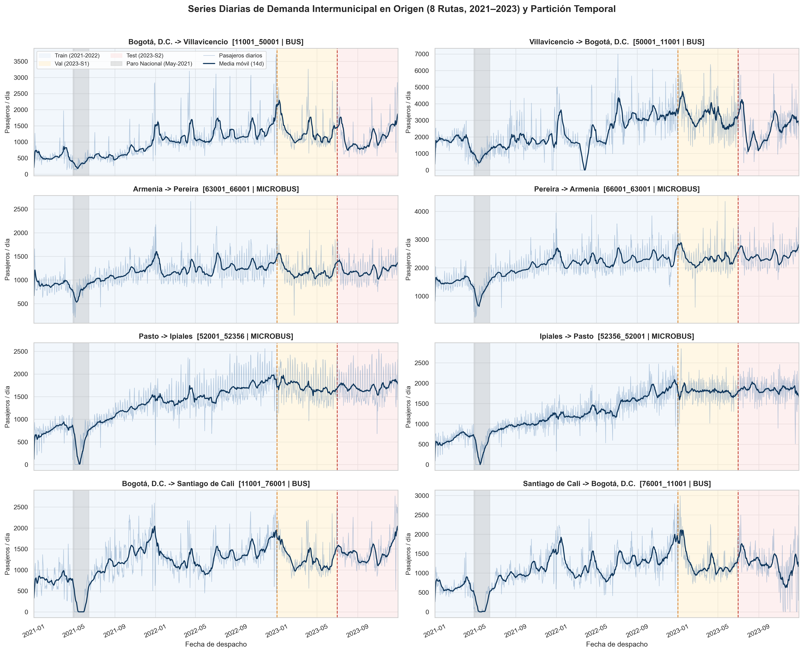
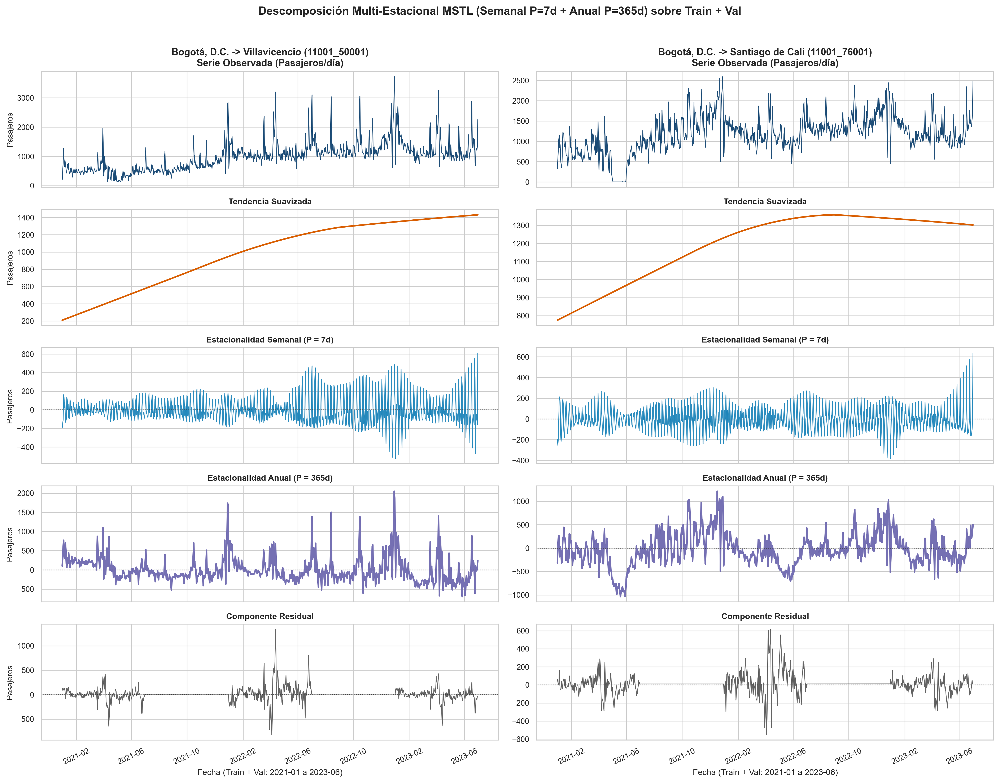
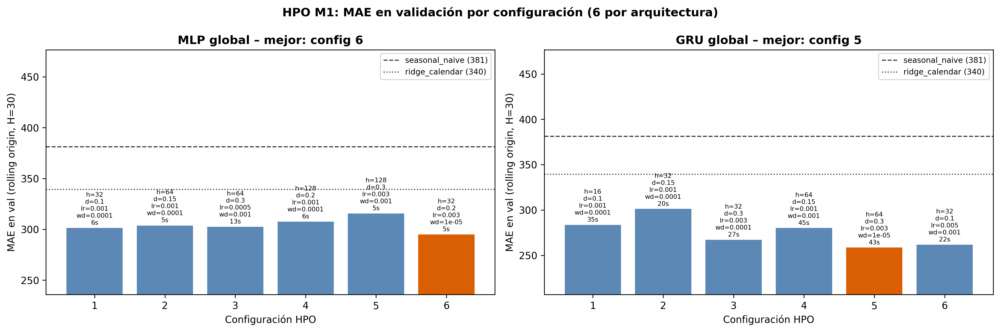
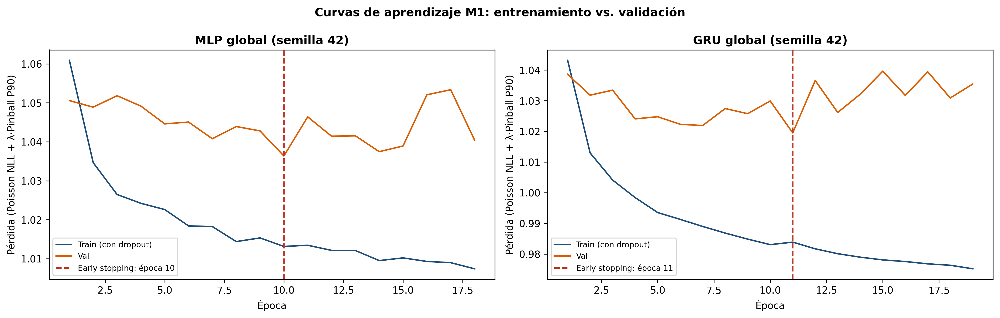
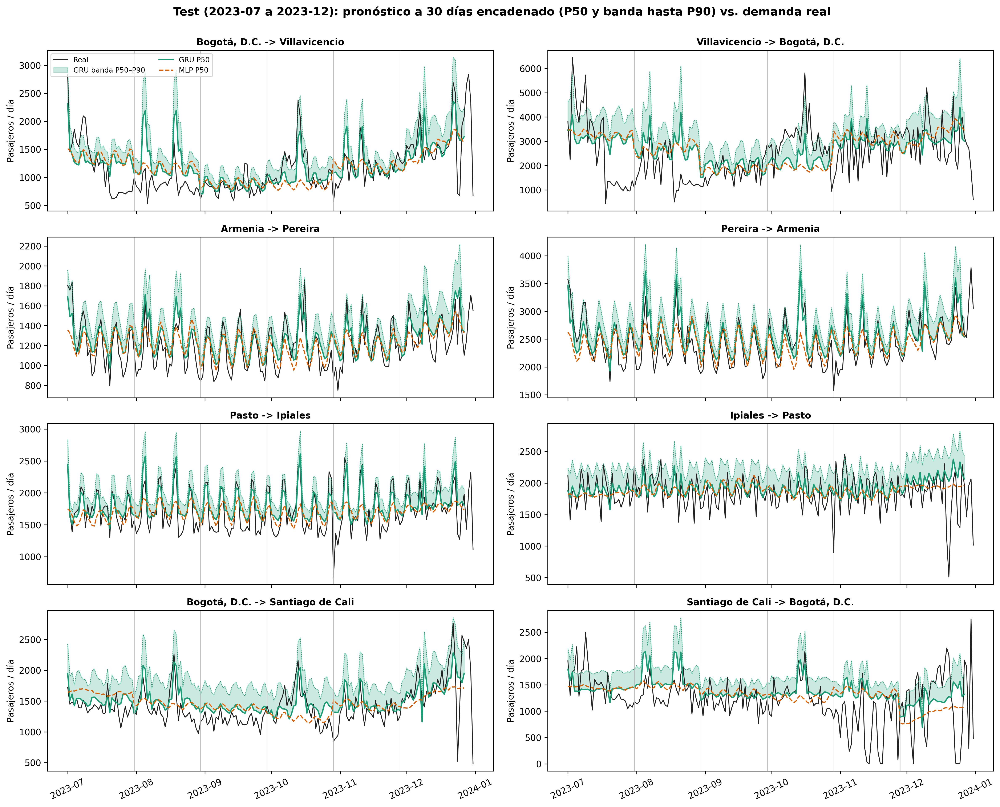
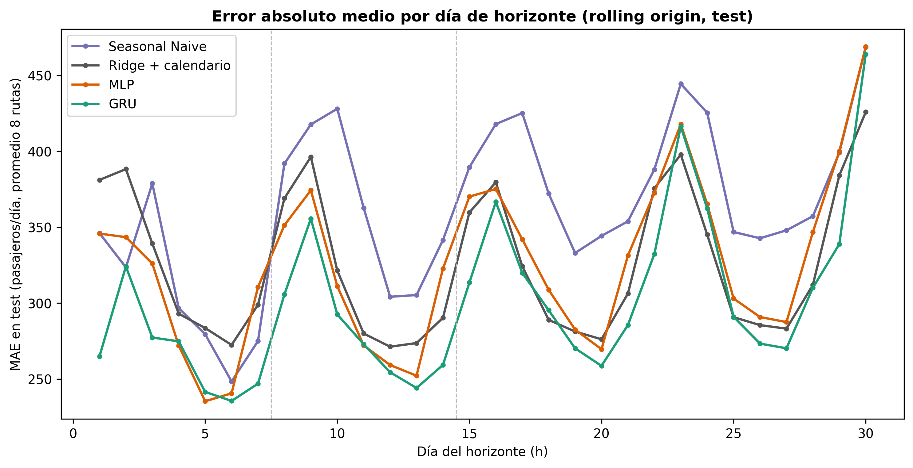
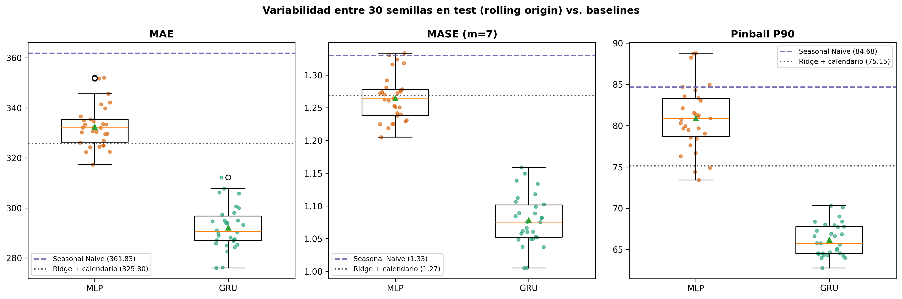
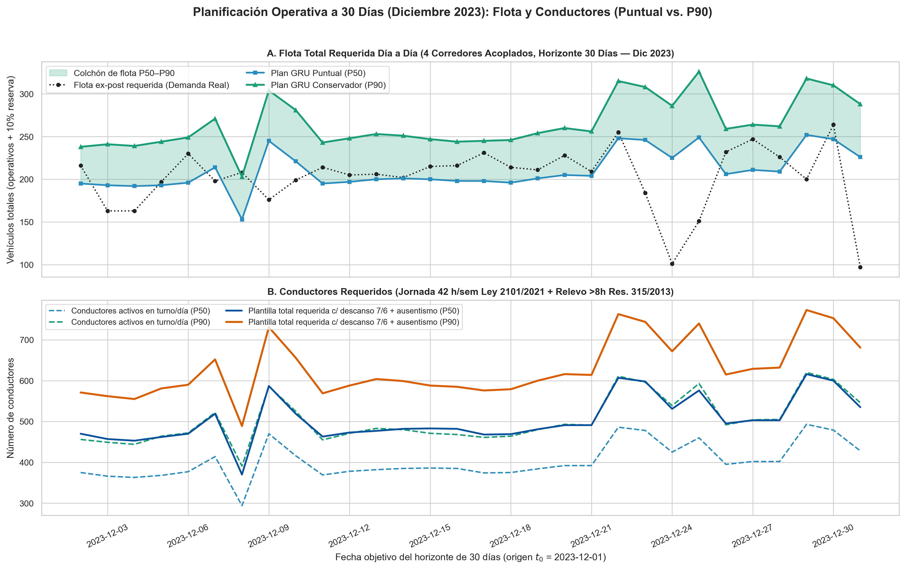
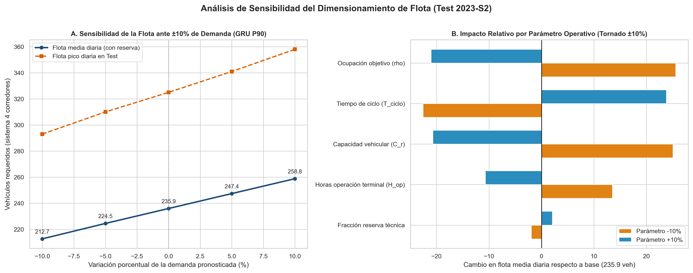

# Reporte Técnico — Módulo 1: Pronóstico Probabilístico de Demanda Intermunicipal y Dimensionamiento Óptimo de Flota y Conductores en Colombia

**Proyecto:** Sistema Integrado de Transporte Inteligente (RN-T3) — Módulo 1 (`modulo1_demanda`)  
**Alcance:** Pronóstico multi-horizonte ($H = 30$ días) sin fuga temporal sobre 4 corredores troncales bidireccionales (8 rutas dirigidas), evaluación estadística sobre 30 semillas y optimización operativa bajo normativa colombiana vigente a 2026.  
**Fuentes de artefactos auditados:** `reports/m1_raw_inspection.txt`, `reports/m1_preprocess_summary.json`, `reports/metrics/m1_eda_summary.json`, `reports/metrics/m1_baselines_metrics.json`, `reports/metrics/m1_hpo_results.json`, `reports/metrics/m1_eval30.json`, `reports/metrics/m1_nn_metrics.json` y `reports/metrics/m1_business_summary.json`.

---

## 1. Contexto del Problema, Fuentes Primarias de Datos e Inconsistencias Detectadas

### 1.1 Contexto Operativo y Fuentes Oficiales
El transporte intermunicipal de pasajeros por carretera constituye el eje vertebral de la conectividad regional en Colombia. A diferencia de los sistemas urbanos de alta frecuencia, la programación táctica intermunicipal exige decidir con semanas de anticipación cuántas unidades físicas asignar a cada corredor, cuántos conductores mantener en nómina activa respetando topes legales de jornada y relevos en rutas largas, y cómo cubrir picos estacionales (Semana Santa, puentes festivos y Navidad) sin incurrir ni en flota propia ociosa durante los meses valle ni en desabastecimiento de sillas en fechas críticas.

El estudio integra dos fuentes primarias oficiales de datos abiertos del Estado colombiano:
1. **Superintendencia de Transporte (SuperTransporte):** conjunto de datos *Operación de pasajeros y despacho de vehículos en la modalidad de transporte de pasajeros por carretera* (identificador Socrata `eh75-8ah6` en el Portal de Datos Abiertos de Colombia, `datos.gov.co`), alimentado por los reportes operativos de las Terminales de Transporte Terrestre habilitadas en el país. La auditoría remota vía SoQL confirmó un volumen global de **49,202,812 registros**, equivalentes a **50,839,100 despachos** y **420,494,779 pasajeros** movilizados entre `2019-08-04` y `2026-04-07` (excluyendo 3 registros con años erróneos).
2. **Departamento Administrativo Nacional de Estadística (DANE):** catálogo oficial de la *División Político-Administrativa de Colombia — DIVIPOLA* (identificador Socrata `gdxc-w37w`), compuesto por **1,122 municipios** únicos codificados mediante cadenas estandarizadas de 5 dígitos (`cod_mpio`: 2 dígitos de departamento + 3 de municipio), empleado para validar integridad geográfica y cruzar nombres oficiales.

El esquema real verificado en la API SODA de SuperTransporte (`eh75-8ah6`) consta exactamente de 10 campos: `terminal` (`text`), `clase_vehiculo` (`text`), `nivel_servicio` (`text`), `municipio_origen_ruta` (`text`), `municipio_destino_ruta` (`text`), `fecha_despacho` (`floating_timestamp`), `hora_despacho` (`text`), `tipo_despacho` (`text`), `despachos` (`number`) y `pasajeros` (`number`).

### 1.2 Inconsistencias Empíricas Detectadas frente al Diccionario Oficial
La auditoría exhaustiva ejecutada en `src/modulo1_demanda/inspect_remote.py` sobre los 49.20 millones de registros reveló siete discrepancias críticas que condicionan cualquier modelado riguroso:

| # | Hallazgo de Auditoría | Evidencia Cuantitativa en `eh75-8ah6` | Implicación para el Pipeline MLOps |
|---|---|---|---|
| 1 | **Codificación textual en `tipo_despacho` y doble conteo por tránsito** | Aunque diccionarios técnicos antiguos refieren códigos `1`/`2`, la base real contiene únicamente las cadenas `'ORIGEN'` (`39,124,098` filas; `334,120,793` pas) y `'TRANSITO'` (`10,078,714` filas; `86,373,986` pas). | Sumar ambos infla rutas largas al registrar el mismo bus en cada terminal intermedia (ej. en Bogotá → Cali más del 80% de registros brutos son pasos en tránsito por Ibagué, Armenia y Tuluá). Se filtra estrictamente `tipo_despacho = 'ORIGEN'`. |
| 2 | **Hueco estructural de cargue en 2024 y diciembre de 2025** | Entre `2021-01` y `2023-12` existen **36 meses continuos** (`588,804` a `889,038` filas/mes en `ORIGEN`). En cambio, `2024-01` tiene **0 registros**, `2024-02` a `2024-12` caen a `1,233`–`20,371` filas/mes (< 2.5% del flujo real) y `2025-12` cae a `10,710` filas. | Entrenar o evaluar cruzando 2024 introduciría un vacío artificial de 12 meses. Se selecciona el bloque continuo íntegro **`2021-01-01` a `2023-12-31` (1,095 días)**. |
| 3 | **Fechas imposibles por error de digitación** | `MAX(fecha_despacho)` reporta `6202-04-13`; existen 3 registros en los años `2202-02`, `2222-09` y `6202-04`, además de rezagos marginales en `2019-08..2020-12`. | Acotar el rango temporal válido elimina el 100% de las marcas de tiempo corruptas. |
| 4 | **Alta proporción de despachos con `pasajeros = 0`** | No existen negativos (`pasajeros < 0`: `0`; `despachos <= 0`: `0`; nulos: `0`), pero **`6,576,784` filas (`13.367%`)** reportan `despachos >= 1` con `pasajeros = 0`. | Corresponden a salidas de reposicionamiento en vacío o planillas sin conteo de ocupación (ej. `14.38%`–`16.22%` de los despachos en Bogotá ↔ Villavicencio). Se auditan explícitamente sin eliminar despachos reales. |
| 5 | **Códigos de destino fuera de DIVIPOLA (`77xxx`) y bucles locales** | `municipio_origen_ruta` cruza al `100.0%` con DANE DIVIPOLA (`369` municipios), pero `municipio_destino_ruta` presenta **`24,364` filas (`0.050%`)** en 6 códigos huérfanos (`77101`–`77106`, pasos/destinos internacionales) y **`319,838` filas (`0.650%`)** con `origen == destino`. | Se excluyen bucles intramunicipales y códigos no pertenecientes a DIVIPOLA. |
| 6 | **Asimetría terminal y anomalía `Cali → Puebloviejo (47570)`** | Rutas suburbanas masivas (`Medellín → Rionegro`: `4.49M` pas; `Pereira → Santa Rosa`: `2.97M` pas) muestran `0` pasajeros en sentido inverso porque el municipio destino carece de Terminal habilitada. Además, `Cali (76001) → Puebloviejo, Magdalena (47570)` registra `3.80M` pas en un solo sentido (>1,100 km sin retorno), atribuible a error de codificación local. | Exigir pares **Ida ↔ Vuelta** verificados en ambos sentidos descarta automáticamente rutas sin terminal de retorno y errores de digitación geográfica. |
| 7 | **Truncamiento HTTP 500 en descargas planas de Socrata** | La descarga directa de archivo completo desde navegador se corta alrededor de `510,274` filas incrustando al final del CSV un bloque JSON `{"error": true, "message": "Internal error", "status": 500}` (5 filas corruptas que fuerzan `float64` y borran ceros iniciales en `05xxx`/`08xxx`). | La ingesta se realiza agregando en servidor mediante consultas SoQL (`GROUP BY municipio_origen_ruta, municipio_destino_ruta, date_trunc_ymd(fecha_despacho)`) leyendo códigos como `str` de 5 dígitos. |

---

## 2. Desarrollo Metodológico y Experimental (Tareas 1 a 8)

### 2.1 Tarea 1: Definición del Caso de Uso y Control Estricto Anti-Fuga a 30 Días
El caso de uso responde a la **programación táctica mensual de flota y nómina de conductores**: en una fecha de corte $t_0$ (conocida hasta el cierre de operación de $t_0$), el operador debe emitir simultáneamente el pronóstico diario para los próximos $H = 30$ días ($t_0 + 1, \dots, t_0 + 30$).

Para impedir cualquier fuga de información futura (*data leakage*) dentro del horizonte de 30 días, `src/modulo1_demanda/preprocess.py` segrega las variables en tres conjuntos disjuntos auditados automáticamente en `tests/test_m1.py`:
1. **`future_known_calendar_exogenous` (18 variables):** funciones deterministas de la fecha calendario futura $t_0 + h$ (conocidas con meses o años de anticipación): día de la semana, mes, día del año, transformaciones cíclicas seno/coseno, indicador de fin de semana, festivos oficiales de Colombia, puentes festivos (salida/retorno), Semana Santa y temporadas vacacionales.
2. **`encoder_step_causal_features_up_to_t0` (11 variables):** rezagos (`lag_1, lag_7, lag_14, lag_28, lag_30`) y estadísticos móviles causales (`roll_mean/std_{7,14,28}_past` con `shift(1)`). En los modelos secuenciales (`MLP` y `GRU`), el encoder lee exclusivamente la ventana histórica $[t_0 - 27, \dots, t_0]$; ningún valor posterior a $t_0$ ingresa jamás al tensor de entrada.
3. **`direct_tabular_h30_safe_features` (7 variables):** `lag_30` y `roll_mean/std_{7,14,28}_h30` construidos con desplazamiento `shift(30)`. Para todo $t = t_0 + h$ con $1 \le h \le 30$, se cumple $t - 30 = t_0 + h - 30 \le t_0$, garantizando que el modelo lineal directo (`ridge_calendar`) solo observe datos en $\le t_0$.

### 2.2 Tarea 2: Selección de Corredores Bidireccionales, Panel Diario y Partición Temporal
A partir del ranking nacional validado en `ORIGEN`, se seleccionaron **4 corredores intermunicipales bidireccionales (8 series dirigidas)** que cubren corta, media y larga distancia, así como las dos tipologías vehiculares predominantes del país (`BUS` y `MICROBUS`). Cada ruta fue reindexada sobre los **1,095 días** del periodo `2021-01-01` a `2023-12-31` (`8 × 1,095 = 8,760` filas exactas, `0` nulos en `pasajeros`, archivo `demanda_diaria.parquet` de **`0.7698 MB`** `< 2.0 MB`):

| `route_id` | Ruta Dirigida (`ORIGEN`) | Vehículo Predom. (% real 21–23) | Ciclo (h) | Días faltantes imputados (`0`) | Pasajeros Totales | Despachos (`% pas=0`) | Media ± Std diaria | Mediana / P90 / Máx | Media Train / Val / Test |
|---|---|---|---:|---:|---:|---:|---:|---:|---:|
| `11001_50001` | Bogotá, D.C. → Villavicencio | `BUS` (49.51%) | 8.0 | 0 | 1,125,807 | 120,515 (14.38%) | 1,028.13 ± 505.24 | 992.0 / 1,616.8 / 3,724 | 934.85 / 1,274.39 / 1,156.00 |
| `50001_11001` | Villavicencio → Bogotá, D.C. | `BUS` (67.60%) | 8.0 | 4 | 2,601,209 | 211,972 (16.22%) | 2,375.53 ± 1,161.47 | 2,176.0 / 3,880.0 / 6,992 | 2,127.34 / 3,258.17 / 2,491.98 |
| `63001_66001` | Armenia → Pereira | `MICROBUS` (94.87%) | 3.0 | 0 | 1,263,730 | 113,231 (3.36%) | 1,154.09 ± 266.96 | 1,133.0 / 1,500.6 / 2,663 | 1,135.98 / 1,173.45 / 1,206.90 |
| `66001_63001` | Pereira → Armenia | `MICROBUS` (79.23%) | 3.0 | 0 | 2,337,691 | 193,387 (2.12%) | 2,134.88 ± 523.04 | 2,114.0 / 2,752.8 / 4,352 | 2,011.22 / 2,319.48 / 2,443.91 |
| `52001_52356` | Pasto → Ipiales | `MICROBUS` (65.97%) | 4.5 | 9 | 1,550,530 | 137,879 (0.37%) | 1,416.01 ± 485.61 | 1,432.0 / 2,094.8 / 2,560 | 1,268.26 / 1,709.45 / 1,713.54 |
| `52356_52001` | Ipiales → Pasto | `MICROBUS` (63.16%) | 4.5 | 14 | 1,501,147 | 137,601 (0.83%) | 1,370.91 ± 527.06 | 1,431.0 / 2,046.6 / 2,848 | 1,147.44 / 1,791.02 / 1,844.26 |
| `11001_76001` | Bogotá, D.C. → Santiago de Cali | `BUS` (100.00%) | 24.0 | 27 | 1,333,474 | 63,019 (1.03%) | 1,217.78 ± 447.26 | 1,233.0 / 1,755.0 / 2,766 | 1,156.82 / 1,260.44 / 1,417.70 |
| `76001_11001` | Santiago de Cali → Bogotá, D.C. | `BUS` (100.00%) | 24.0 | 31 | 1,210,446 | 59,476 (1.12%) | 1,105.43 ± 464.51 | 1,104.0 / 1,683.4 / 2,989 | 1,046.13 / 1,235.43 / 1,212.83 |

La partición temporal es estrictamente cronológica:
- **Train (`2021-01-01` a `2022-12-31`):** `730` días/ruta (`5,840` filas; 2 ciclos anuales completos).
- **Validation (`2023-01-01` a `2023-06-30`):** `181` días/ruta (`1,448` filas; incluye Semana Santa y mitad de año).
- **Test (`2023-07-01` a `2023-12-31`):** `184` días/ruta (`1,472` filas; incluye puentes del segundo semestre, cierres en Vía al Llano jul–ago 2023 y temporada alta navideña completa).

### 2.3 Tarea 3: Análisis Exploratorio (EDA), Descomposición MSTL y Verificación de Hipótesis
El módulo `src/modulo1_demanda/eda.py` contrastó cuantitativamente las cuatro hipótesis estructurales sobre `Train + Val` (`2021-01-01` a `2023-06-30`, sin tocar `Test`) y documentó su persistencia en `Test` (`reports/metrics/m1_eda_summary.json`):

1. **H1 — Efecto día de la semana (Viernes/Domingo vs. Martes/Miércoles):** **Confirmada** ($p = 6.24 \times 10^{-12}$, prueba U de Mann-Whitney). En `Train + Val`, la demanda media los viernes (`1,544.14` pas/día) y domingos (`1,432.88` pas/día; media conjunta `1,488.73`) supera en **`+10.96%`** a los martes y miércoles (`1,341.70` pas/día). El efecto es especialmente pronunciado en corredores conmutantes regionales como `Armenia → Pereira` (`+24.40%`) y `Pereira → Armenia` (`+19.85%`). En `Test` el diferencial se mantiene significativo (`1,727.74` vs `1,591.02`, **`+8.59%`**, $p = 4.91 \times 10^{-3}$).
2. **H2 — Efecto festivos y puentes festivos (Ley Emiliani):** **Confirmada** ($p = 2.20 \times 10^{-10}$). En `Train + Val`, los días pertenecientes a puentes festivos promedian `1,611.48` vs `1,406.50` pas/día en días fuera de puente (**`+14.57%`**), disparándose en los **viernes de operación éxodo (`1,751.66` pas/día, `+24.54%`)**. Destaca la asimetría direccional: en `Bogotá → Villavicencio` el puente eleva la demanda `+33.19%` con pico el viernes de salida (`1,657.73`), mientras en el retorno `Villavicencio → Bogotá` el lunes festivo alcanza `3,506.46` pas/día (`4,000.57` en `Test`). En `Test`, el incremento global en puente es de **`+15.53%`** (`+27.80%` en viernes de salida, $p = 1.02 \times 10^{-6}$).
3. **H3 — Efecto temporadas altas (Semana Santa, mitad de año y fin de año):** **Confirmada**. Frente a la línea base de temporada valle en `Train + Val` (`1,366.33` pas/día), **Semana Santa** incrementa el flujo en **`+25.16%`** (`1,710.07`), las vacaciones de mitad de año (`jun–jul`) en **`+2.80%`** (`1,404.56`), la ventana `dic–ene` en **`+20.99%`** (`1,653.10`) y **diciembre** de forma aislada en **`+35.47%`** (`1,850.98` pas/día). En `Test`, diciembre promedia `1,917.82` pas/día (**`+19.42%`** sobre el valle del segundo semestre `1,605.90`).
4. **H4 — Recuperación post-pandemia y choque del Paro Nacional (mayo 2021):** **Confirmada**. El promedio diario global pasa de `1,061.98` pas/día en `2021` a `1,645.02` en `2022` (**`+54.90%`**) y `1,719.03` en `2023` completo (**`+4.50%`** adicional; **`+61.87%`** acumulado frente a 2021). Durante mayo de 2021 (Paro Nacional, ventana crítica `2021-04-28` a `2021-06-15`), la demanda cayó **`-65.84%`** frente al resto de 2021 (`390.67` vs `1,143.72` pas/día), llegando al cierre casi total en el suroccidente del país: **`-99.54%`** en `Bogotá → Cali` (`5.13` pas/día, 27 días sin operación), **`-99.09%`** en `Cali → Bogotá` (`8.19` pas/día, 31 días sin operación) y **`-76.65%` / `-74.10%`** en `Pasto ↔ Ipiales`.

La descomposición multi-estacional `MSTL` ($P_1 = 7\text{d}, P_2 = 365\text{d}$) ajustada exclusivamente sobre `Train + Val` (`911` días) evidencia la tendencia creciente de reactivación 2021–2022, la ampliación de la oscilación semanal conforme crece el volumen y los pulsos anuales de diciembre y Semana Santa:

### 2.4 Tarea 4: Ingeniería de Exógenas del Calendario Colombiano (Ley 51 de 1983)
Bajo la **Ley 51 de 1983 (Ley Emiliani)**, diez festividades religiosas y cívicas en Colombia se trasladan al lunes siguiente, configurando puentes festivos cuya fecha exacta cambia cada año (además de los festivos móviles anclados al Domingo de Pascua: Jueves y Viernes Santo, Ascensión del Señor, Corpus Christi y Sagrado Corazón). Utilizando el paquete `holidays` (`country='CO'`) y el algoritmo astronómico gregoriano de Meeus/Jones/Butcher para Pascua, se generó y persistió `data/processed/m1/calendario_exogenas.csv` (`1,130` días desde `2021-01-01` hasta `2024-02-04`, garantizando operación **100% offline** incluso al proyectar 30 días hacia enero de 2024), incluyendo:
- Armónicos cíclicos continuos: `dow_sin`, `dow_cos` ($P=7$), `month_sin`, `month_cos` ($P=12$) y `doy_sin`, `doy_cos` ($P=365.25$).
- Indicadores binarios de régimen operativo: `is_weekend`, `is_holiday_co`, `is_puente_festivo` (viernes a lunes en lunes Emiliani; viernes a domingo en viernes festivo fijo), `is_salida_puente` (viernes previo al lunes festivo), `is_retorno_puente` (lunes festivo), `is_semana_santa` (10 días desde Viernes de Dolores hasta Domingo de Pascua), `is_temporada_mitad_anio` (`jun–jul`) e `is_temporada_fin_anio` (`dic–ene`).

### 2.5 Tarea 5: Modelos de Referencia (Baselines) y Protocolo Rolling Origin
En `src/modulo1_demanda/baselines.py` se implementó un evaluador reutilizable de **origen rodante (*rolling origin*)** con horizonte $H = 30$ días y paso de avance de $7$ días:
- En **`Val` (`2023-01-01` a `2023-06-30`):** `22` orígenes (`2022-12-31` a `2023-05-27`) $\times 8$ rutas $\times 30$ días = **`5,280` pronósticos**.
- En **`Test` (`2023-07-01` a `2023-12-31`):** `23` orígenes (`2023-06-30` a `2023-12-01`) $\times 8$ rutas $\times 30$ días = **`5,520` pronósticos** (el último origen `2023-12-01` cubre exactamente hasta el `2023-12-31`).

Se evaluaron dos baselines entrenados estrictamente en `Train`:
1. **`seasonal_naive` (`8` parámetros, `1.95 s`):** repite el último ciclo semanal observado en $t_0$, $\hat{y}_{r, t_0+h} = y_{r, t_0 + ((h-1) \bmod 7) - 6}$, y estima $\hat{q}_{0.90}$ sumando el percentil 90 empírico de los residuales multi-paso en `Train` por ruta (`413.0` a `1,292.1` pas).
2. **`ridge_calendar` (`88` parámetros = $2 \times (43 + 1)$, `16.56 s`):** modelo lineal global `Ridge` ($\alpha = 1.0$ seleccionado en `Val` sobre $\{0.1, 1, 10, 50, 100\}$) para el pronóstico puntual y `QuantileRegressor` ($\tau = 0.90, \alpha = 0.001$, solver HiGHS) para P90, alimentados con `direct_tabular_h30_safe_features` + `FUTURE_CALENDAR_COLS` + `OneHot(route_id)` + interacciones parsimoniosas `direction × calendario` y `route_id × roll_mean_28_h30`.

### 2.6 Tarea 6: Arquitecturas Neuronales Globales (`MLP` vs. `GRU`), Escalado por Ventana y Pérdida Híbrida
En `src/modulo1_demanda/models.py` y `nn_data.py` se implementaron dos arquitecturas globales en PyTorch (optimizadas para CPU con 4 hilos) que comparten un `nn.Embedding(num_routes=8, emb_dim=8)`:
- **Normalización dinámica de nivel por ventana:** dado que las series exhiben fuerte crecimiento interanual (`+61.87%` entre 2021 y 2023) y choques abruptos (Paro Nacional y cierres viales), cada ventana histórica en $t_0$ define la escala estrictamente positiva:
  $$s_{r, t_0} = \max\!\left(\frac{1}{L}\sum_{\ell=0}^{L-1} y_{r, t_0-\ell},\; 0.25\,\bar{y}_{r,\text{train}},\; 1.0\right), \quad L = 28$$
  El piso `0.25 * route_train_mean` evita divisiones cercanas a cero cuando una vía estuvo cerrada durante 28 días, y $\log(s_{r, t_0} / \bar{y}_{r,\text{train}})$ se entrega a la red como señal explícita de régimen relativo. Al inferir, $(\hat{\mu}, \hat{q}_{0.90})$ se reescalan multiplicando por $s_{r, t_0}$.
- **`GlobalMLPForecaster`:** concatena los 28 días históricos escalados + las $30 \times 14 = 420$ señales de calendario futuro aplanadas + el embedding de ruta (`8`) + `log_level` (`1`) —dimensión de entrada `457`— a través de `num_layers = 2` capas densas `Linear -> ReLU -> Dropout` y proyecta los $2 \times 30 = 60$ parámetros de salida en paralelo (*direct multi-step*).
- **`GlobalGRUForecaster`:** codifica secuencialmente los $L = 28$ pasos históricos $[\tilde{y}_{r, \tau}; \mathbf{c}_\tau] \in \mathbb{R}^{15}$ mediante un encoder `nn.GRU`; el estado oculto final $\mathbf{h}_{t_0}$ se concatena para cada paso futuro $h \in \{1, \dots, 30\}$ con el embedding de ruta, `log_level`, el vector exógeno $\mathbf{c}_{t_0+h}$ y la posición relativa $h/30$, aplicando un decodificador MLP compartido de dos capas que preserva la estructura temporal de cada día futuro.
- **Cabeza dual positiva sin cruce cuantílico y pérdida híbrida:** cada horizonte $h$ aplica $\hat{\mu}_h = \text{Softplus}(z_{\mu, h}) + 10^{-4}$ y $\hat{q}_{0.90, h} = \hat{\mu}_h + \text{Softplus}(z_{\Delta, h}) \ge \hat{\mu}_h$, optimizando con `AdamW` y recorte de gradiente (`1.0`) la suma `PoissonNLLLoss(log_input=False)` + $\lambda_{\text{pinball}} \cdot \text{Pinball}_{\tau=0.90}$ ($\lambda_{\text{pinball}} = 1.0$).

### 2.7 Tarea 7: Búsqueda de Hiperparámetros (HPO) y Protocolo de 30 Semillas
El modo `--mode hpo` evaluó un presupuesto explícito de **6 configuraciones por arquitectura** (semilla `42`, máximo `40` épocas, paciencia `6`, tiempo total de pared **`233.69 s`** en CPU: `39.87 s` para MLP y `191.75 s` para GRU), seleccionando por menor MAE rolling-origin en `Val` (`5,280` pronósticos):

| Arq. | Config ID | `hidden_size` | `dropout` | `lr` | `weight_decay` | Parámetros | Mejor Época / Corridas | Tiempo (s) | Val MAE | Val RMSE | Val MASE | Val Pinball P90 | Val Cob. P90 |
|---|---:|---:|---:|---:|---:|---:|---:|---:|---:|---:|---:|---:|---:|
| `MLP` | 1 | 32 | 0.10 | 0.0010 | 1e-4 | 17,756 | 11 / 17 | 5.52 | 301.37 | 465.32 | 1.2104 | 78.38 | 90.15% |
| `MLP` | 2 | 64 | 0.15 | 0.0010 | 1e-4 | 37,436 | 7 / 13 | 5.28 | 303.73 | 476.04 | 1.2042 | 77.94 | 93.31% |
| `MLP` | 3 | 64 | 0.30 | 0.0005 | 1e-3 | 37,436 | 19 / 25 | 12.87 | 302.44 | 470.02 | 1.2091 | 79.89 | 90.95% |
| `MLP` | 4 | 128 | 0.20 | 0.0010 | 1e-4 | 82,940 | 7 / 13 | 6.22 | 307.56 | 482.12 | 1.2041 | 75.60 | 91.59% |
| `MLP` | 5 | 128 | 0.30 | 0.0030 | 1e-3 | 82,940 | 7 / 13 | 5.06 | 315.55 | 484.79 | 1.2556 | 79.06 | 91.27% |
| **`MLP` ★** | **6** | **32** | **0.20** | **0.0030** | **1e-5** | **17,756** | **10 / 16** | **4.93** | **294.96** | **459.46** | **1.1718** | **80.96** | **91.69%** |
| `GRU` | 1 | 16 | 0.10 | 0.0010 | 1e-4 | 2,338 | 19 / 25 | 34.71 | 283.68 | 450.98 | 1.1080 | 67.64 | 91.61% |
| `GRU` | 2 | 32 | 0.15 | 0.0010 | 1e-4 | 6,658 | 5 / 11 | 19.94 | 301.23 | 463.17 | 1.2167 | 74.75 | 93.62% |
| `GRU` | 3 | 32 | 0.30 | 0.0030 | 1e-4 | 6,658 | 11 / 17 | 26.66 | 267.18 | 434.30 | 1.0396 | 68.79 | 92.01% |
| `GRU` | 4 | 64 | 0.15 | 0.0010 | 1e-3 | 21,442 | 13 / 19 | 45.14 | 280.20 | 457.45 | 1.0686 | 69.01 | 88.98% |
| **`GRU` ★** | **5** | **64** | **0.30** | **0.0030** | **1e-5** | **21,442** | **11 / 17** | **43.10** | **258.61** | **425.61** | **0.9926** | **63.51** | **89.19%** |
| `GRU` | 6 | 32 | 0.10 | 0.0050 | 1e-3 | 6,658 | 7 / 13 | 22.21 | 261.75 | 434.83 | 1.0146 | 68.90 | 87.92% |

*(Referencias en `Val`: `seasonal_naive` MAE `381.38`, MASE `1.4280` | `ridge_calendar` MAE `339.52`, MASE `1.3960`).*

Con las configuraciones ganadoras (`MLP` cfg 6 y `GRU` cfg 5), `--mode single` persistió los checkpoints definitivos y las curvas de aprendizaje (donde el *early stopping* actúa en las épocas `10` y `11` sobre `5,384` muestras de entrenamiento y `1,216` de validación):

### 2.8 Tarea 8: Evaluación Rolling Origin en `Test` (30 Semillas vs. Baselines)
Para descartar dependencia de la inicialización aleatoria, `--mode eval30` entrenó desde cero **30 semillas independientes (`42` a `71`)** tanto para `MLP` como para `GRU` y las evaluó bajo el mismo protocolo *rolling origin* en `Test` (`23` orígenes, `5,520` pronósticos):

#### Tabla 2.8.A — Comparativa global y por bloques de horizonte en `Test`

| Modelo | Parámetros | Tiempo / corrida | MAE Global | RMSE Global | MASE ($m=7$) | MAE `1–7d` | MAE `8–14d` | MAE `15–30d` | Pinball P90 | Cobertura P90 |
|---|---:|---:|---:|---:|---:|---:|---:|---:|---:|---:|
| `seasonal_naive` | 8 | 1.95 s | 361.83 | 606.61 | 1.3300 | 306.82 | 364.45 | 384.74 | 84.68 | 89.33% |
| `ridge_calendar` ($\alpha=1.0$) | 88 | 16.56 s | 325.80 | 492.28 | 1.2689 | 322.34 | 314.56 | 332.24 | 75.15 | 89.17% |
| **MLP global** (`30` semillas) *`[mejor, peor]`* | 17,756 | 6.00 ± 1.96 s | 332.48 ± 8.25 `[317.30, 352.01]` | 528.52 ± 13.32 `[505.18, 566.56]` | 1.2646 ± 0.0347 `[1.2051, 1.3334]` | 297.35 ± 8.05 `[279.41, 315.77]` | 312.92 ± 7.91 `[297.80, 330.44]` | 356.40 ± 10.95 `[338.53, 386.58]` | 80.90 ± 3.92 `[73.41, 88.76]` | 91.38 ± 0.74% `[90.24%, 93.59%]` |
| **GRU global** (`30` semillas) *`[mejor, peor]`* | 21,442 | 35.67 ± 6.85 s | **292.19 ± 8.69** **`[276.02, 312.24]`** | **476.18 ± 11.26** **`[458.13, 503.79]`** | **1.0780 ± 0.0382** **`[1.0053, 1.1590]`** | **265.53 ± 6.67** **`[252.63, 279.54]`** | **277.38 ± 7.99** **`[263.18, 293.32]`** | **310.33 ± 10.60** **`[290.02, 337.19]`** | **66.19 ± 1.97** **`[62.78, 70.30]`** | **89.04 ± 1.94%** `[85.34%, 92.95%]` |

#### Tabla 2.8.B — Desglose por ruta en `Test` (`690` pronósticos/ruta; checkpoints semilla `42` en `m1_nn_metrics.json` vs. Baselines)

| `route_id` | Ruta Dirigida | `Seasonal Naive` MAE / MASE / PinP90 | `Ridge` MAE / MASE / PinP90 | `MLP (s=42)` MAE / MASE / PinP90 | `GRU (s=42)` MAE / MASE / PinP90 | Cobertura P90 `GRU` |
|---|---|---:|---:|---:|---:|---:|
| `11001_50001` | Bogotá → Villavicencio | 349.51 / 1.572 / 89.32 | 309.42 / 1.392 / 72.32 | 286.51 / 1.289 / 73.47 | **266.52 / 1.199 / 59.58** | 85.65% |
| `50001_11001` | Villavicencio → Bogotá | 1,076.98 / 1.787 / 232.52 | **889.09 / 1.475** / 207.56 | 925.55 / 1.536 / 221.14 | 901.97 / 1.496 / **190.35** | 81.16% |
| `63001_66001` | Armenia → Pereira | 165.56 / 1.185 / 39.07 | 165.68 / 1.186 / 33.63 | 144.54 / 1.035 / 35.82 | **126.52 / 0.906 / 26.40** | 93.19% |
| `66001_63001` | Pereira → Armenia | 275.14 / 1.232 / 63.79 | 243.64 / 1.091 / 55.14 | 223.73 / 1.002 / 64.33 | **200.18 / 0.896 / 44.08** | 96.81% |
| `52001_52356` | Pasto → Ipiales | 176.96 / 1.154 / 42.64 | 250.23 / 1.631 / 56.19 | 249.68 / 1.628 / 52.57 | **175.33 / 1.143 / 33.66** | 97.68% |
| `52356_52001` | Ipiales → Pasto | 193.18 / 1.143 / 44.63 | 221.06 / 1.308 / 48.35 | 209.92 / 1.242 / 55.73 | **186.16 / 1.102 / 42.56** | 96.67% |
| `11001_76001` | Bogotá → Cali | 258.95 / 0.883 / 66.06 | 196.97 / 0.672 / 54.11 | 217.10 / 0.740 / 55.32 | **196.47 / 0.670 / 49.58** | 97.10% |
| `76001_11001` | Cali → Bogotá | 398.34 / 1.685 / 99.39 | **330.32 / 1.397** / 73.88 | 342.54 / 1.449 / 79.15 | 351.45 / 1.486 / **70.30** | 89.42% |

**Hallazgos experimentales clave:**
- **Superioridad uniforme en las 30 semillas:** las 30 realizaciones de `GRU` superan simultáneamente a `seasonal_naive` y `ridge_calendar` en `MAE` (peor semilla `312.24 < 325.80`), `MASE` (peor semilla `1.1590 < 1.2689`) y `Pinball P90` (peor semilla `70.30 < 75.15`). En promedio, `GRU` reduce el MAE en **`-10.32%`** respecto a `ridge_calendar` y **`-19.25%`** respecto a `seasonal_naive`, y reduce la Pinball Loss P90 en **`-11.92%`** y **`-21.84%`**.
- **Sinergia corto + largo plazo:** mientras `MLP` mejora en `1–7d` (`297.35`) pero se degrada en `15–30d` (`356.40 > 332.24` de Ridge) por aplanar los 420 rasgos de calendario en una sola matriz densa propensa a sobreajuste, el decodificador por paso de la `GRU` mantiene la menor curva de error desde $h=1$ (`264.90`) hasta $h=29$ (`338.84`), con cobertura empírica media de **`89.04% ± 1.94%`** frente al nominal `90.0%`.
- En julio–agosto de 2023 el corredor `Villavicencio ↔ Bogotá` sufrió cierres viales exógenos por la avalancha de Quetame (visibles en el panel superior derecho de `fig_m1_03`), lo que explica su menor cobertura P90 relativa (`81.16%`) y mayor RMSE en todos los modelos.

---

## 3. Análisis de Decisiones Operativas y Caso de Negocio (Preguntas 1 a 4)

Todos los cálculos operativos en `src/modulo1_demanda/business_fleet.py` se evaluaron sobre los **184 días únicos del semestre `Test` (`2023-07-01` a `2023-12-31`, `2,481,627` pasajeros reales)** leyendo los parámetros normativos y económicos desde `config/m1_demanda.yaml`:
- **Capacidad nominal y ocupación objetivo:** `BUS` = `42` sillas, `MICROBUS` = `19` sillas, factor de ocupación objetivo $\rho = 0.85$ (`35.70` y `16.15` sillas efectivas/despacho), ventana de operación en terminal $H_{\text{op}} = 18.0\text{ h/día}$ y reserva técnica $r_{\text{res}} = 10\%$.
- **Marco normativo laboral y de transporte vigente en Colombia a 2026:**
  1. **Ley 2101 de 2021** (reducción gradual plena desde el 15 de julio de 2026): jornada ordinaria máxima de **`42.0` horas semanales** (`7.0 h/día` promedio en 6 días laborables con 1 día de descanso obligatorio remunerado, factor de cobertura semanal $7/6 \approx 1.1667$).
  2. **Decreto 1393 de 1970 (Art. 56)** y **Ley 2466 de 2025 (Art. 13)**: tope máximo diario de **`10.0` horas** incluyendo hasta 2 horas extra diarias, articulado con pausas activas de `30 min` del Plan Estratégico de Seguridad Vial (**PESV, Resolución 40595 de 2022**).
  3. **Resolución 315 de 2013 del Ministerio de Transporte (Art. 6)**: obligación de asignar **segundo conductor (relevo a bordo)** cuando el recorrido por sentido supera las **`8.0` horas** —regla activada automáticamente en `Bogotá ↔ Cali` ($12.0\text{ h/sentido} > 8.0\text{ h} \implies \text{crew} = 2$)— más tasa de ausentismo operativo del `6%` (multiplicador total de plantilla $1.1667 / 0.94 = 1.2412$).

### 3.1 Preguntas 1 y 2: Dimensionamiento de Flota Acoplada, Sensibilidad y Plantilla de Conductores

| Corredor Bidireccional (`A ↔ B`) | Clase (`C_r`) | Ciclo (h) | Vueltas / veh-día ($V_c$) | Despachos/día Media (Pico) | Flota Operativa Media (Pico) | Flota Total +10% Reserva Media (Pico) | Tripulación / despacho | Conductores Activos/día Media (Pico) | Conductores en Plantilla Media (Pico) |
|---|---|---:|---:|---:|---:|---:|---:|---:|---:|
| `Armenia ↔ Pereira` | `MICROBUS` (19) | 3.0 | 6.00 | 267.23 (387) | 29.95 (44) | **33.37 (49)** | 1 | 61.06 (88) | **76.80 (110)** |
| `Pasto ↔ Ipiales` | `MICROBUS` (19) | 4.5 | 4.00 | 266.37 (340) | 35.88 (46) | **39.97 (51)** | 1 | 90.83 (116) | **113.72 (145)** |
| `Bogotá ↔ Villavicencio` | `BUS` (42) | 8.0 | 2.25 | 144.14 (244) | 45.17 (80) | **50.17 (88)** | 1 | 87.32 (147) | **109.42 (183)** |
| `Bogotá ↔ Cali` *(24h: 1 desp/veh-día)* | `BUS` (42) | 24.0 | 0.50 | 101.72 (149) | 101.72 (149) | **112.42 (164)** | **2** *(Res. 315)* | 203.45 (298) | **253.67 (371)** |
| **Total Sistema (`GRU P90`)** | Mixta | — | — | **779.46 (1,086)** | **212.72 (294)** | **235.93 (325)** | — | **442.65 (620)** | **553.61 (773)** |
| *Referencia Sistema (`GRU Puntual`)* | Mixta | — | — | *663.65 (889)* | *174.32 (234)* | *193.43 (258)* | — | *365.99 (497)* | *458.25 (621)* |

- **Análisis de sensibilidad ($\pm 10\%$ de demanda y Tornado de parámetros sobre base `235.93` veh):**
  - Variar la demanda en `-10% / -5% / +5% / +10%` ajusta casi linealmente la flota total media a **`212.65` (`-9.87%`) / `224.47` (`-4.86%`) / `247.37` (`+4.85%`) / `258.78` vehículos (`+9.69%`)**, y la plantilla media de conductores de `499.30` a `607.88`.
  - **Parámetro operativo más influyente ($\pm 10\%$):** **`Ocupación objetivo` ($\rho$)** con una oscilación total de **`46.61` vehículos (`19.76%`**: sube a `261.50` veh si $\rho$ baja $-10\%$ y cae a `214.89` veh si $\rho$ sube $+10\%$), seguido estrechamente por **`Tiempo de ciclo`** (`46.36` veh, `19.65%`) y **`Capacidad vehicular`** (`45.74` veh, `19.39%`), por encima de **`Horas de operación terminal`** (`24.20` veh, `10.26%`) y **`Fracción de reserva técnica`** (`4.02` veh, `1.70%`).

### 3.2 Pregunta 3: Valor Económico del Pronóstico (`Puntual` vs. `P90` y `GRU` vs. `Ridge`)
Comparando cada política contra la flota operativa ex-post realmente requerida por la demanda observada (con costo de vehículo-día ocioso \$420,000 COP en `BUS` y \$240,000 COP en `MICROBUS` —referencia media \$330,000 COP— y penalidad por pasajero desatendido de \$55,000 COP):

| Escenario Operativo (`Test`, 184 días) | Pasajeros sin atender (% de `2,481,627`) | Vehículos-día sobrantes | Vehículos-día faltantes | Costo sobrantes (MM COP) | Costo faltantes (MM COP) | Costo total de desajuste (MM COP) |
|---|---:|---:|---:|---:|---:|---:|
| `Ridge Puntual` | `87,535` (`3.527%`) | **3,197** | 2,673 | \$1,243.74 | \$4,814.43 | \$6,058.17 |
| `Ridge P90` | `15,015` (`0.605%`) | 9,095 | 549 | \$3,496.80 | \$825.83 | \$4,322.63 |
| `GRU Puntual` | `47,766` (`1.925%`) | 3,879 | 1,693 | \$1,518.30 | \$2,627.13 | \$4,145.43 |
| **`GRU P90` (Óptimo)** | **`7,171` (`0.289%`)** | 9,523 | **271** | \$3,665.76 | **\$394.41** | **\$4,060.17** |

- **Umbral crítico $(c_{\text{corto}} / c_{\text{sobrante}})^*$:** en la `GRU`, migrar de `Puntual` a `P90` evita **`40,595` pasajeros sin atender** adicionando `5,644` vehículos-día sobrantes, por lo que el umbral de indiferencia es:
  $$r^*_{\text{GRU}} = \frac{\Delta S}{\Delta U} = \frac{9{,}523 - 3{,}879}{47{,}766 - 7{,}171} = \frac{5{,}644}{40{,}595} = 0.1390 \text{ veh-día / pasajero}$$
  Valorado frente al costo de referencia de sobrante (\$330,000 COP/veh-día), **operar con `P90` es económicamente superior siempre que perder un pasajero cueste al menos \$45,881 COP** (bajo los costos configurados $r = 55{,}000 / 330{,}000 = 0.1667 > 0.1390$).
- **Justificación operativa de la `GRU` frente a `Ridge`:** la `GRU` reduce el costo semestral de desajuste en **\$1,912.74 millones COP** bajo política puntual (`-45.4%` pasajeros sin atender) y en **\$262.46 millones COP** bajo política `P90` (~**\$525 millones COP/año**), reduciendo en **`-52.24%`** los pasajeros dejados en tierra (`7,171` vs `15,015`) con una inferencia en CPU menor a `0.15 s`.

### 3.3 Pregunta 4: Temporada Alta (Navidad Diciembre 2023 vs. Semana Normal) y Esquema de Flota
Al contrastar la semana pico navideña (`2023-12-22` a `2023-12-28`) frente a una semana ordinaria sin festivos (`2023-09-11` a `2023-09-17`) bajo `GRU P90`:

| Corredor | Clase | Flota Media Normal | Flota Media Pico Dic | Flota Máx Pico Dic | Vehículos Adicionales Pico | Plantilla Normal | Plantilla Máx Pico | Conductores Adicionales |
|---|---|---:|---:|---:|---:|---:|---:|---:|
| `Armenia ↔ Pereira` | `MICROBUS` | 30.86 | 40.43 | 49 | **+18** | 70.00 | 110 | **+40** |
| `Pasto ↔ Ipiales` | `MICROBUS` | 39.29 | 45.57 | 50 | **+10** | 112.29 | 145 | **+32** |
| `Bogotá ↔ Villavicencio` | `BUS` | 36.43 | 67.14 | 88 | **+51** | 78.00 | 183 | **+105** |
| `Bogotá ↔ Cali` | `BUS` | 102.57 | 134.71 | 151 | **+48** | 230.86 | 341 | **+110** |
| **Sistema Consolidado** | Mixta | **209.14** | **287.86** | **321** | **+127 (`99 BUS + 28 MICRO`)** | **491.14** | **756** | **+265** *(neto simultáneo)* |

Para cubrir los `+127` vehículos adicionales requeridos únicamente durante ~`52` días de temporada alta al año:
1. **Flota 100% propia dedicada al pico:** **\$15,846.00 millones COP/año** (inviable financieramente por mantener >100 unidades ociosas más de 310 días/año).
2. **Fletamento / arrendamiento estacional (`1.35×` costo diario en días pico):** **\$3,390.66 millones COP/año** (ahorro del **`78.60%`**).
3. **Convenios de colaboración empresarial (Decreto 1079 de 2015, comisión `12%` sobre despachos cedidos):** **\$2,172.20 millones COP/año** (ahorro del **`86.29%`**).
- **Recomendación ejecutiva:** estructura híbrida de tres capas: **flota propia** dimensionada sobre la base permanente (`~205–210` vehículos), **arrendamiento temporal** para las semanas continuas de diciembre y mitad de año, y **convenios interempresariales** para absorber las puntas extremas de 3 a 5 días (`22–24 dic`, `29–30 dic` y salida de Semana Santa).

---

## 4. Limitaciones Metodológicas y Operativas del Estudio

1. **Subregistro de pasajeros que abordan en vía (observabilidad exclusiva en terminal de origen):**  
   Los registros de SuperTransporte (`tipo_despacho = 'ORIGEN'`) contabilizan únicamente los pasajeros que compran tiquete y abordan dentro de la infraestructura física de la Terminal de Transporte de despacho inicial. En la práctica operativa colombiana —particularmente en corredores cortos y medios como `Armenia ↔ Pereira`, `Pasto ↔ Ipiales` o salidas periféricas de Bogotá— una fracción relevante de viajeros aborda en paraderos intermedios sobre carretera ("recogida en vía"). En consecuencia, $y_{r,t}$ representa una **cota inferior** de la ocupación real en tramo; si la empresa dimensiona al límite sin considerar el ascenso en ruta, se arriesga a sobrecupo en carretera o sanciones viales, razón adicional que respalda el uso del cuantil conservador `P90` y una ocupación objetivo en terminal $\rho = 0.85 < 1.0$.

2. **Acoplamiento direccional Ida–Vuelta de las 8 series en vueltas y reposicionamiento por corredor:**  
   Aunque el modelo neuronal global pronostica las 8 series dirigidas de forma conjunta, las demandas reales presentan fuertes **asimetrías estructurales y temporales por sentido** (por ejemplo, `Villavicencio → Bogotá` promedia `2,375.53` pas/día frente a `1,028.13` en `Bogotá → Villavicencio`, y en puentes festivos el éxodo ocurre el viernes hacia fuera de Bogotá mientras el retorno se concentra el lunes festivo). Dado que los vehículos físicos son activos acoplados al corredor $c = \{A \to B, B \to A\}$, atender $\max(D_{AB,t}, D_{BA,t})$ despachos en el sentido dominante obliga a retornar unidades en vacío o con baja ocupación en el contraflujo (lo cual explica empíricamente el `14.4%–16.2%` de despachos con `pasajeros = 0` observados en la base cruda). Nuestro motor captura este acoplamiento al nivel diario mediante $\max(D_{AB,t}, D_{BA,t})/V_c$, pero una programación intradía hora a hora requeriría un modelo de flujo en redes espacio-temporales con inventario explícito de buses en cada terminal al cierre nocturno.

3. **Censura por la derecha de la demanda observada por restricción de oferta (*demand censoring*):**  
   El dataset histórico registra **pasajeros efectivamente movilizados** (ventas realizadas), no **demanda latente total** (intención de viaje). En días pico como el 23 de diciembre, Miércoles Santo o lunes festivos de retorno, cuando se agota la capacidad física de sillas y la flota autorizada de las empresas en terminal, la serie observada queda truncada superiormente en el tope de oferta disponible ($y^{\text{obs}}_{r,t} = \min(y^{\text{latente}}_{r,t}, \text{Capacidad Máxima}_{r,t})$). Por tanto, incluso el cuantil empírico `P90` aprendido sobre $y^{\text{obs}}_{r,t}$ puede subestimar la verdadera demanda latente en horas de agotamiento de tiquetes, haciendo indispensable complementar estos pronósticos con registros de consultas web rechazadas o tiempos de agotamiento de taquilla cuando estén disponibles.

---

## 5. Fundamentación Matemática Formal

### 5.1 Compuertas del Encoder GRU y Decodificador Multi-Horizonte de Doble Cabeza
Sea $\mathbf{x}_\tau = [\tilde{y}_{r,\tau};\, \mathbf{c}_\tau] \in \mathbb{R}^{1 + d_c}$ el vector de entrada causal en cada paso histórico $\tau \in \{t_0 - L + 1, \dots, t_0\}$, donde $\tilde{y}_{r,\tau} = y_{r,\tau} / s_{r,t_0}$. La celda **Gated Recurrent Unit (GRU)** (Cho et al., 2014) actualiza su estado oculto $\mathbf{h}_\tau \in \mathbb{R}^{d_h}$ mediante las compuertas de actualización $\mathbf{z}_\tau$ y reinicio $\mathbf{r}_\tau$:

$$\mathbf{z}_\tau = \sigma(\mathbf{W}_{xz}\mathbf{x}_\tau + \mathbf{W}_{hz}\mathbf{h}_{\tau-1} + \mathbf{b}_z)$$

$$\mathbf{r}_\tau = \sigma(\mathbf{W}_{xr}\mathbf{x}_\tau + \mathbf{W}_{hr}\mathbf{h}_{\tau-1} + \mathbf{b}_r)$$

$$\tilde{\mathbf{h}}_\tau = \tanh\!\big(\mathbf{W}_{xh}\mathbf{x}_\tau + \mathbf{W}_{hh}(\mathbf{r}_\tau \odot \mathbf{h}_{\tau-1}) + \mathbf{b}_h\big)$$

$$\mathbf{h}_\tau = (1 - \mathbf{z}_\tau) \odot \mathbf{h}_{\tau-1} + \mathbf{z}_\tau \odot \tilde{\mathbf{h}}_\tau$$

donde $\sigma(\cdot)$ es la función sigmoide logística y $\odot$ denota el producto de Hadamard. Al alcanzar $\tau = t_0$, el contexto latente se concatena para cada paso futuro $h \in \{1, \dots, H\}$ con el embedding de ruta $\mathbf{e}_r \in \mathbb{R}^{d_e}$, el nivel logarítmico $\ell_{r,t_0} = \log(s_{r,t_0}/\bar{y}_{r,\text{train}})$, las exógenas futuras conocidas $\mathbf{c}_{t_0+h}$ y la posición normalizada $h/H$:

$$\mathbf{u}_{r, t_0, h} = \big[\text{Dropout}(\mathbf{h}_{t_0});\, \mathbf{e}_r;\, \ell_{r, t_0};\, \mathbf{c}_{t_0+h};\, h/H\big], \qquad [z_{\mu, h},\, z_{\Delta, h}]^\top = f_{\theta_{\text{dec}}}(\mathbf{u}_{r, t_0, h})$$

Las predicciones escaladas y reescaladas en conteos de pasajeros se obtienen garantizando positividad estricta y **ausencia exacta de cruce cuantílico** ($\hat{q}_{0.90, h} \ge \hat{\mu}_h > 0$):

$$\tilde{\mu}_h = \log(1 + e^{z_{\mu, h}}) + \varepsilon, \qquad \tilde{q}_{0.90, h} = \tilde{\mu}_h + \log(1 + e^{z_{\Delta, h}}), \qquad (\hat{\mu}_h, \hat{q}_{0.90, h}) = s_{r, t_0}\cdot(\tilde{\mu}_h, \tilde{q}_{0.90, h})$$

con $\varepsilon = 10^{-4}$.

### 5.2 Derivación de la Poisson NLL (Cuasi-Verosimilitud Escalada) y de la Pinball Loss
1. **Verosimilitud de Poisson e invarianza bajo escalado por ventana:** si $Y \mid \mathbf{x} \sim \text{Poisson}(\mu)$ con media condicional $\mu > 0$, su función de masa es $P(Y = y \mid \mu) = \frac{\mu^y e^{-\mu}}{y!}$, cuya log-verosimilitud negativa (omitiendo $\log y!$, constante respecto a los parámetros) es:
   $$\mathcal{L}_{\text{Poisson}}(y, \mu) = \mu - y \log \mu$$
   Al reescalar por la constante positiva conocida en el origen $s = s_{r, t_0} > 0$, definiendo $\tilde{y} = y/s$ y $\tilde{\mu} = \mu/s$, la pérdida de cuasi-verosimilitud evaluada en espacio normalizado satisface:
   $$\mathcal{L}_{\text{Poisson}}(\tilde{y}, \tilde{\mu}) = \tilde{\mu} - \tilde{y}\log\tilde{\mu} = \frac{1}{s}\big(\mu - y\log\mu\big) + \frac{y\log s}{s}$$
   Derivando respecto a $\tilde{\mu}$, $\frac{\partial}{\partial \tilde{\mu}} \mathbb{E}[\tilde{\mu} - \tilde{Y}\log\tilde{\mu} \mid \mathbf{x}] = 1 - \frac{\mathbb{E}[\tilde{Y}\mid \mathbf{x}]}{\tilde{\mu}} = 0 \iff \tilde{\mu}^* = \mathbb{E}[\tilde{Y}\mid \mathbf{x}] \iff \mu^* = s\tilde{\mu}^* = \mathbb{E}[Y\mid \mathbf{x}]$. Así, la cuasi-verosimilitud preserva intacto el estimador consistente de la media condicional mientras equilibra la magnitud de los gradientes entre rutas de distinto volumen.

2. **Pinball Loss desde la Distribución Asimétrica de Laplace (ALD):** un error $u = y - q$ sigue una distribución $\text{ALD}(0, \sigma, \tau)$ con parámetro de asimetría $\tau \in (0, 1)$ si su densidad es:
   $$f_\tau(u \mid \sigma) = \frac{\tau(1-\tau)}{\sigma}\exp\!\left(-\frac{\rho_\tau(u)}{\sigma}\right), \qquad \rho_\tau(u) = u\big(\tau - \mathbb{I}(u < 0)\big) = \max\big(\tau u,\, (\tau - 1)u\big)$$
   Maximizar la log-verosimilitud $\sum \log f_\tau(y_i - q_i \mid \sigma)$ respecto a $q_i$ equivale exactamente a minimizar la **Pinball Loss** $\rho_\tau(y_i - q_i)$ (Koenker & Bassett, 1978), cuya condición de primer orden $\mathbb{P}(Y \le q^*_\tau \mid \mathbf{x}) = \tau$ recupera el cuantil condicional verdadero. La pérdida híbrida minimizada sobre el horizonte es:
   $$\mathcal{L}_{\text{total}} = \frac{1}{B \cdot H}\sum_{b=1}^{B}\sum_{h=1}^{H}\Big[\big(\tilde{\mu}_{b,h} - \tilde{y}_{b,h}\log(\tilde{\mu}_{b,h} + \epsilon)\big) + \lambda_{\text{pinball}}\,\rho_{0.90}\big(\tilde{y}_{b,h} - \tilde{q}_{0.90, b, h}\big)\Big]$$

### 5.3 Métricas Formales de Evaluación Puntual y Probabilística
Para cada ruta $r$ con serie de entrenamiento $y_{r,1}, \dots, y_{r,T_{\text{train}}}$ y estacionalidad semanal $m = 7$, el **Mean Absolute Scaled Error (MASE)** (Hyndman & Koehler, 2006), la **cobertura empírica** $\hat{C}_\tau$ y la **pérdida cuantílica** en evaluación se definen como:

$$S_r = \frac{1}{T_{\text{train}} - m}\sum_{t=m+1}^{T_{\text{train}}} |y_{r,t} - y_{r,t-m}|, \qquad \text{MASE} = \frac{1}{|\mathcal{E}|}\sum_{(r,i)\in\mathcal{E}} \frac{|y_{r,i} - \hat{y}_{r,i}|}{S_r}$$

$$\hat{C}_{0.90} = \frac{1}{|\mathcal{E}|}\sum_{(r,i)\in\mathcal{E}} \mathbb{I}\!\left(y_{r,i} \le \hat{q}_{0.90, r, i}\right), \qquad \text{Pinball}_{0.90} = \frac{1}{|\mathcal{E}|}\sum_{(r,i)\in\mathcal{E}} \rho_{0.90}\!\left(y_{r,i} - \hat{q}_{0.90, r, i}\right)$$

### 5.4 Modelo Matemático de Dimensionamiento de Flota, Conductores y Umbral Económico
Sea $\hat{d}_{r,t} \in \{\hat{\mu}_{r,t}, \hat{q}_{0.90,r,t}\}$ la demanda planificada en la ruta $r$ el día $t$, $C_r$ la capacidad nominal del vehículo tipo, $\rho \in (0,1]$ la ocupación objetivo y $T_{\text{ciclo}, c}$ el tiempo de ciclo completo del corredor $c = \{r^+, r^-\}$:

$$D_{r,t} = \left\lceil \frac{\hat{d}_{r,t}}{C_r \cdot \rho} \right\rceil, \qquad F^{\text{op}}_{c,t} = \begin{cases} \left\lceil \dfrac{\max(D_{r^+, t},\, D_{r^-, t})}{H_{\text{op}} / T_{\text{ciclo}, c}} \right\rceil, & T_{\text{ciclo}, c} \le H_{\text{op}} \\[10pt] \left\lceil \dfrac{D_{r^+, t} + D_{r^-, t}}{24 / T_{\text{ciclo}, c}} \right\rceil, & T_{\text{ciclo}, c} > H_{\text{op}} \end{cases}, \qquad F^{\text{tot}}_{c,t} = \left\lceil F^{\text{op}}_{c,t}(1 + r_{\text{res}}) \right\rceil$$

Con recorrido por sentido $T_{\text{ow}, r} = T_{\text{ciclo}, r}/2$, pausa activa $b$, tope diario $H_{\max} = 10\text{ h}$ y jornada ordinaria diaria $h_{\text{ord}} = 42/6 = 7\text{ h}$, los conductores activos $K^{\text{act}}_{r,t}$ y en plantilla $K^{\text{nom}}_{r,t}$ (con factor de descanso $f_{\text{desc}} = 7/6$ y ausentismo $\alpha_{\text{aus}}$) vienen dados por:

$$K^{\text{act}}_{r,t} = \begin{cases} 2\,D_{r,t}, & T_{\text{ow}, r} > 8\text{ h} \\[6pt] \max\!\left(\left\lceil \dfrac{D_{r,t}}{\lfloor (H_{\max} - b)/T_{\text{ow}, r}\rfloor} \right\rceil,\; \left\lceil \dfrac{D_{r,t}\big(T_{\text{ow}, r} + b\cdot T_{\text{ow}, r}/H_{\max}\big)}{h_{\text{ord}}} \right\rceil\right), & T_{\text{ow}, r} \le 8\text{ h} \end{cases}, \qquad K^{\text{nom}}_{r,t} = \left\lceil \frac{f_{\text{desc}}}{1 - \alpha_{\text{aus}}} K^{\text{act}}_{r,t} \right\rceil$$

Finalmente, sean $U(\pi) = \sum_{r,t}\max(0, y_{r,t} - D_{r,t}(\pi)C_r)$ los pasajeros desatendidos y $S(\pi) = \sum_{c,t}\max(0, F^{\text{op}}_{c,t}(\pi) - F^{\text{op},*}_{c,t})$ los vehículos-día sobrantes bajo la política $\pi \in \{\text{P50}, \text{P90}\}$. La política conservadora $\text{P90}$ minimiza el costo esperado de desajuste $c_{\text{corto}} U(\pi) + c_{\text{sobrante}} S(\pi)$ sí y solo si:

$$\frac{c_{\text{corto}}}{c_{\text{sobrante}}} > r^* = \frac{S(\text{P90}) - S(\text{P50})}{U(\text{P50}) - U(\text{P90})}$$

---

## 6. Referencias Bibliográficas (APA 7)

- Cho, K., van Merriënboer, B., Gulcehre, C., Bahdanau, D., Bougares, F., Schwenk, H., & Bengio, Y. (2014). Learning phrase representations using RNN encoder–decoder for statistical machine translation. In *Proceedings of the 2014 Conference on Empirical Methods in Natural Language Processing (EMNLP)* (pp. 1724–1734). Association for Computational Linguistics. https://doi.org/10.3115/v1/D14-1179
- Congreso de la República de Colombia. (1983, 6 de diciembre). *Ley 51 de 1983: Por la cual se traslada el descanso remunerado de algunos días festivos* (Ley Emiliani). Diario Oficial No. 36.402.
- Congreso de la República de Colombia. (2021, 15 de julio). *Ley 2101 de 2021: Por medio de la cual se reduce la jornada laboral semanal de manera gradual, sin disminuir el salario de los trabajadores y se dictan otras disposiciones*. Diario Oficial No. 51.736.
- Congreso de la República de Colombia. (2025, 25 de junio). *Ley 2466 de 2025: Por medio de la cual se modifica parcialmente normas laborales y se adopta una reforma laboral para el trabajo decente y digno en Colombia* (Art. 13, límite de horas extras). Diario Oficial de la República de Colombia.
- Departamento Administrativo Nacional de Estadística [DANE]. (2026). *DIVIPOLA — Códigos municipios (`gdxc-w37w`)* [Conjunto de datos]. Portal de Datos Abiertos de Colombia. https://www.datos.gov.co/resource/gdxc-w37w
- Hyndman, R. J., & Koehler, A. B. (2006). Another look at measures of forecast accuracy. *International Journal of Forecasting*, 22(4), 679–688. https://doi.org/10.1016/j.ijforecast.2006.03.001
- Koenker, R., & Bassett, G., Jr. (1978). Regression quantiles. *Econometrica*, 46(1), 33–50. https://doi.org/10.2307/1913643
- Ministerio de Transporte de Colombia. (2013, 6 de febrero). *Resolución 315 de 2013: Por la cual se adoptan unas medidas para garantizar la seguridad en el transporte público terrestre automotor y se dictan otras disposiciones* (Art. 6, segundo conductor en rutas mayores a ocho horas). Diario Oficial No. 48.696.
- Ministerio de Transporte de Colombia. (2015, 26 de mayo). *Decreto 1079 de 2015: Por medio del cual se expide el Decreto Único Reglamentario del Sector Transporte* (Convenios de colaboración empresarial). Diario Oficial No. 49.523.
- Ministerio de Transporte de Colombia. (2022, 12 de julio). *Resolución 40595 de 2022: Por la cual se adopta la metodología para el diseño, implementación y verificación de los Planes Estratégicos de Seguridad Vial (PESV)*. Diario Oficial No. 52.093.
- Presidencia de la República de Colombia. (1970, 4 de agosto). *Decreto 1393 de 1970: Por el cual se expide el Estatuto Nacional del Transporte Terrestre Automotor* (Art. 56, jornada máxima diaria de conducción). Diario Oficial No. 33.139.
- Superintendencia de Transporte [SuperTransporte]. (2026). *Operación de pasajeros y despacho de vehículos en la modalidad de transporte de pasajeros por carretera (`eh75-8ah6`)* [Conjunto de datos]. Portal de Datos Abiertos de Colombia. https://www.datos.gov.co/resource/eh75-8ah6
